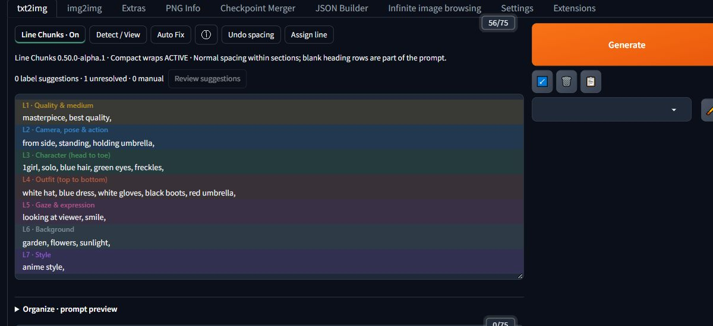

# Line Chunks for Forge

**Make your positive prompt easier to read and write.**

I'm testing this extension to make using Line Chunks easier inside Forge. It labels and colours the chunks in your original prompt box, while keeping normal typing, Tag Autocomplete and resizing.



## Install

1. In Forge, open **Extensions → Install from URL**.
2. Paste this into **URL for extension's git repository**:

   ```text
   https://github.com/chibi-mage/line-chunks
   ```

3. Leave the other fields blank and click **Install**.
4. Open **Installed**, click **Apply and restart UI**, then refresh the page when Forge is ready.

You'll find **Line Chunks** and **Detect / View** above the positive prompt. If you used an earlier manual installation, see [updating](docs/installation.md#updating) first.

## Try it

- Write or paste a positive prompt, then turn **Line Chunks** on or click **Detect / View**.
- For a fresh prompt, open **Organize · prompt preview → Templates** and choose a starter.
- Keep writing in the normal prompt box. Use **Assign line** when you want to change a line's label.

It works with the main positive prompts in **txt2img** and **img2img**. Negative and ADetailer prompts stay manual.

**Organize & review** lets you inspect an arrangement before applying it. **Auto Fix** is optional and handles supported prompts; tangled prompts can still need your judgement. Reordering tags can change the generated image.

This is an **alpha**. [Report a bug](https://github.com/chibi-mage/line-chunks/issues/new?template=bug_report.yml) if something goes wrong.

[User guide](docs/user-guide.md) · [Installation and updates](docs/installation.md) · [Troubleshooting](docs/troubleshooting.md) · [Known limitations](docs/known-limitations.md) · [Releases](https://github.com/chibi-mage/line-chunks/releases)

## Development

Run `npm test` with Node 18+. Python 3.9+ runs `python tools/test_package_alpha.py` and `python tools/package-alpha.py`. No dependency installation is needed for those checks. [Contribution guidance](https://github.com/chibi-mage/line-chunks/blob/main/CONTRIBUTING.md) covers the text engine and source boundaries; [host checks](https://github.com/chibi-mage/line-chunks/blob/main/docs/host-compatibility.md) record tested builds and verification limits.

Original extension code is [MIT licensed](LICENSE). No bulk external tag catalog or private reference fixtures are bundled.
