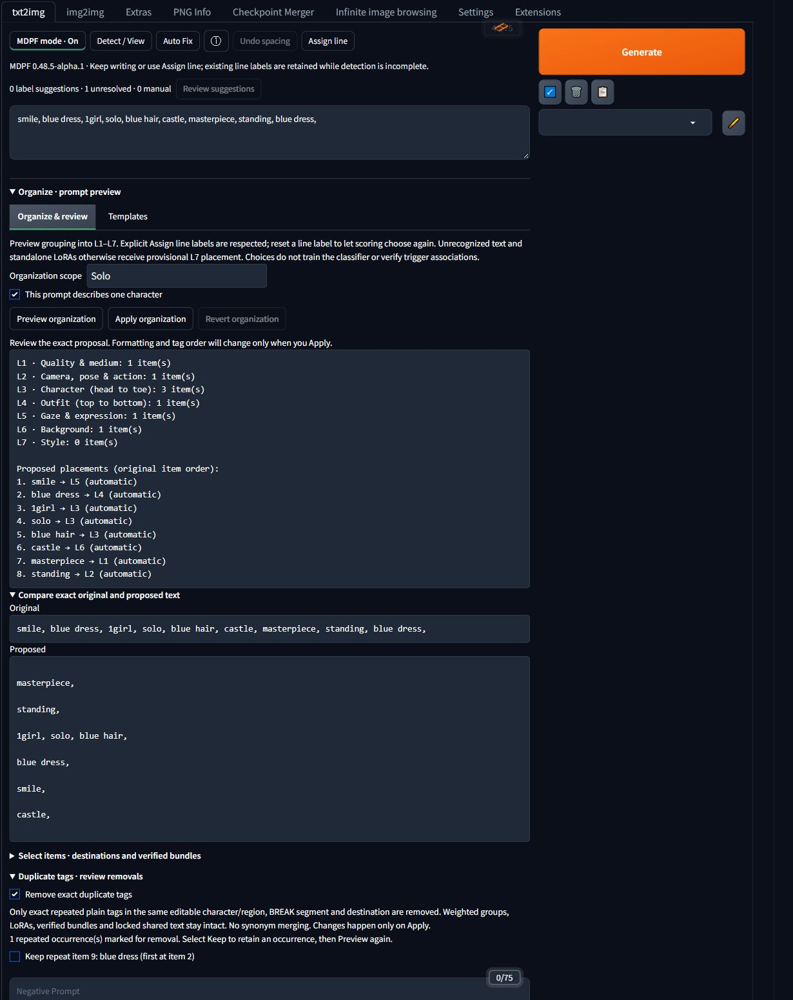
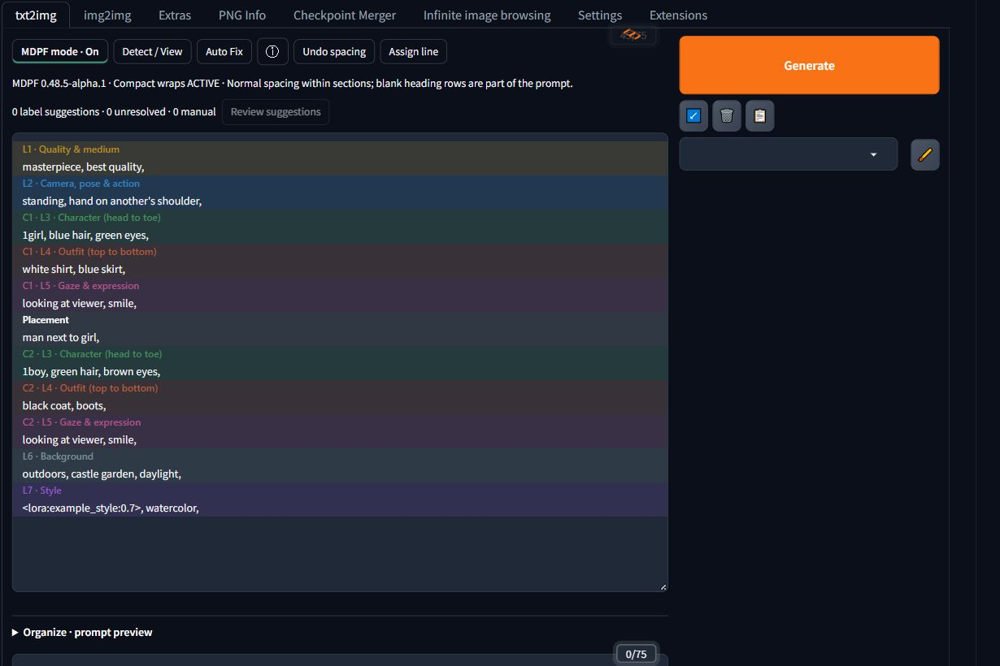

# MDPF Editor for Forge Neo

**Readable, structured positive prompts in Forge's original textbox.**

MDPF adds colored section headings and character labels while keeping native typing, selection, resizing and Tag Autocomplete. Its main purpose is helping you understand and write structured prompts; automatic organization is a secondary convenience.

Private alpha **0.48.5-alpha.1** · [User guide](docs/user-guide.md) · [Installation](docs/installation.md) · [Report a bug](https://github.com/chibi-mage/mdpf-editor/issues/new?template=bug_report.yml)

## Install

1. Download a successful **Forge CI** build from [Actions](https://github.com/chibi-mage/mdpf-editor/actions). Repository access is required while it is private. Extract the artifact download to find the actual Forge ZIP and checksum.
2. Close Forge and extract the inner `mdpf-editor-0.48.5-alpha.1-forge-private-alpha.zip` into `extensions`. The result should include `extensions/mdpf-editor/javascript/mdpf-forge.mjs`, with no extra nested folder.
3. Start Forge and refresh its page with **Ctrl+F5**, after keeping a copy of any open prompt.

No extra pip/npm dependencies or Forge core changes are needed. See [installation, updates and removal](docs/installation.md) for rollback instructions.

## First use

1. Write or paste a positive prompt in **txt2img** or **img2img**, then choose **MDPF mode** or **Detect / View**.
2. For a fresh structured prompt, open **Organize · prompt preview → Templates** below the prompt and insert a starter. Choose Solo, a two-character placement layout, or a multi-character Forge Couple layout.
3. Keep typing in the original textbox. Use **Assign line** to correct a section label. A label describes structure; it does not prove every tag on the line belongs there.

| Section | Purpose |
| --- | --- |
| L1 | Quality and medium |
| L2 | Camera, pose and action |
| L3 | Character, generally head to toe |
| L4 | Outfit and accessories, generally top to bottom |
| L5 | Gaze and expression |
| L6 | Background, scenery and scene effects |
| L7 | Style and LoRA references |

[Five-minute starting guide](docs/user-guide.md#five-minute-starting-guide) · [Full user guide](docs/user-guide.md)

## Organize an imported prompt

**Organize & review** lets you inspect proposed destinations, correct individual items and keep intentional repeats before **Apply organization**. **Auto Fix** writes immediately for eligible solo or configured Basic Forge Couple prompts. Its result includes duplicate/unknown counts and Details.

Exact plain duplicates are removed by default only within the same destination, character/region and BREAK segment. Revert is available while its exact result remains current; it is not permanent Undo history. Unknown triggers may use provisional L7, and ambiguous or unsupported prompts need review or manual rewriting. MDPF does not infer LoRA–trigger relationships.

See a preview with exact comparison and duplicate review

The screenshot shows a proposal only. The duplicate is marked for removal, and the source stays unchanged until Apply.

## Multiple characters

Keep characters in distinct blocks with their own outfit/expression sections. Starters support an ordinary two-character placement layout and **2–8 characters** in Forge Couple layouts. Reviewed organization also supports explicit character ranges and structured BREAK imports; see the [workflow guide](docs/user-guide.md#choose-a-workflow).

See two characters with a placement line and shared scene

This is an ordinary placement-line prompt, not a demonstration of regional conditioning. The example LoRA name is a placeholder; no model or LoRA was loaded for these screenshots.

MDPF never configures Forge Couple. Match its separator and shared-region settings yourself. Distinct expressions can bleed across characters; regional conditioning or later inpainting may help. Text labels alone do not isolate conditioning.

## Compatibility and limits

- Tested locally on **Forge Neo with Gradio 4.40.0**. Other Forge builds/themes and A1111 require validation. ComfyUI is outside this project.
- Only the main positive prompts are supported. Negative and ADetailer prompts are outside scope. MDPF does not change models or generation settings.
- Compact display may insert real blank heading rows when explicitly enabled/detected. Labels are editor metadata, but those blank rows are part of copied prompt text.
- Organization is bounded to **20,000 source characters and 200 editable items**. Complex syntax or uncertain ownership can block the entire proposal.
- Draft saving and native resizing are confirmed working by the owner. Save/load is optional; pending organization choices and Undo remain page-local.

The current phase is [normal-use stabilization](https://github.com/chibi-mage/mdpf-editor/blob/main/docs/stabilization.md). The [verification status](https://github.com/chibi-mage/mdpf-editor/blob/main/docs/known-issues.md) distinguishes live checks from automated evidence. These UI screenshots show neutral authored prompts, not generated-image results.

[Troubleshooting](docs/troubleshooting.md) · [Known limitations](docs/known-limitations.md) · [Core/Forge boundaries](docs/portability.md)

## Development

Run `npm test` with Node 18+; no dependency installation is needed. Python 3.9+ runs `python tools/test_package_alpha.py` and `python tools/package-alpha.py`. The GitHub source contains neutral self-contained tests; the private workspace's additional fixtures and historical evaluations are excluded. See [contribution guidance](https://github.com/chibi-mage/mdpf-editor/blob/main/CONTRIBUTING.md) and [CI/download details](https://github.com/chibi-mage/mdpf-editor/blob/main/docs/ci.md).

## License

Original extension code is [MIT licensed](LICENSE). No bulk external Tag Autocomplete/Danbooru dataset is bundled. Rights to separately sourced datasets are not established by this code license.
